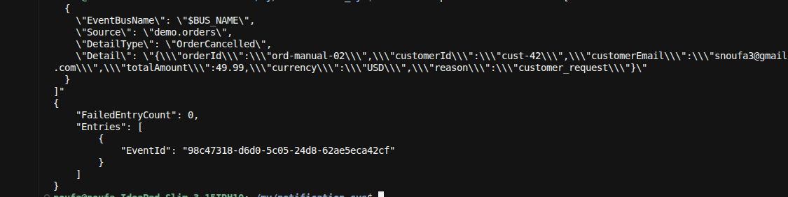
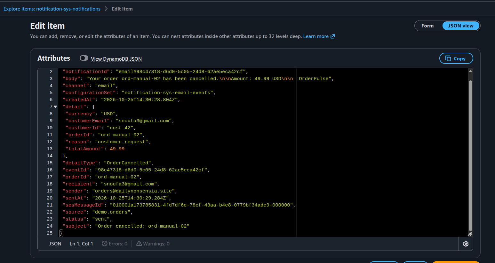
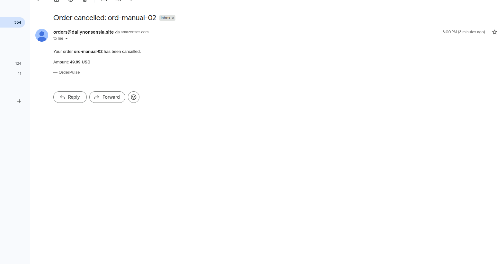
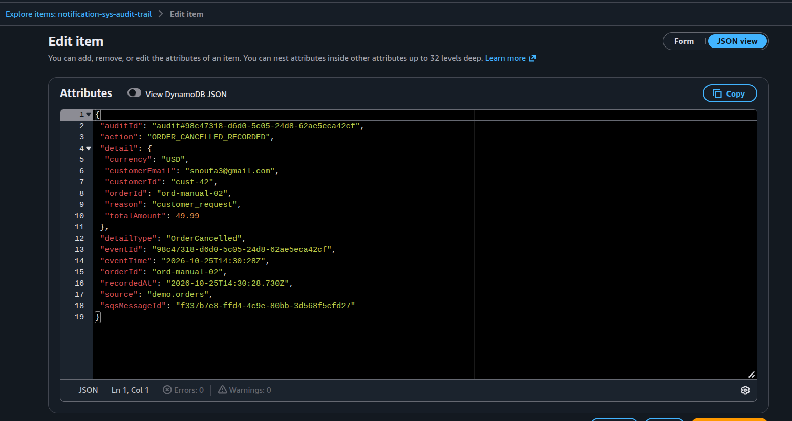

**E2E-02** = publish `OrderCancelled` and confirm SES + audit both succeed.

### 0. Deploy (if needed)
```bash
./scripts/deploy.sh
```

### 1. Resolve outputs
```bash
export BUS_NAME=$(aws cloudformation describe-stacks --stack-name notification-sys \
  --query "Stacks[0].Outputs[?OutputKey=='EventBusName'].OutputValue" --output text)
export NOTIF_TABLE=$(aws cloudformation describe-stacks --stack-name notification-sys \
  --query "Stacks[0].Outputs[?OutputKey=='NotificationsTableName'].OutputValue" --output text)
export AUDIT_TABLE=$(aws cloudformation describe-stacks --stack-name notification-sys \
  --query "Stacks[0].Outputs[?OutputKey=='AuditTableName'].OutputValue" --output text)
```

### 2. Publish OrderCancelled
```bash
aws events put-events --entries "[
  {
    \"EventBusName\": \"$BUS_NAME\",
    \"Source\": \"demo.orders\",
    \"DetailType\": \"OrderCancelled\",
    \"Detail\": \"{\\\"orderId\\\":\\\"ord-manual-02\\\",\\\"customerId\\\":\\\"cust-42\\\",\\\"customerEmail\\\":\\\"snoufa3@gmail.com\\\",\\\"totalAmount\\\":49.99,\\\"currency\\\":\\\"USD\\\",\\\"reason\\\":\\\"customer_request\\\"}\"
  }
]"
```
Expect: `FailedEntryCount: 0`.



Or: `./scripts/publish-event.sh events/order-cancelled.json` (uses `ord-1001`).

### 3. Wait ~10s, then check notifications
```bash
aws dynamodb query \
  --table-name "$NOTIF_TABLE" \
  --index-name by-order \
  --key-condition-expression "orderId = :o" \
  --expression-attribute-values '{":o":{"S":"ord-manual-02"}}' \
  | jq '.Items[0] | {status:.status.S, subject:.subject.S, recipient:.recipient.S, detailType:.detailType.S, sesMessageId:.sesMessageId.S}'
```

**Pass if:**
- `status` = `sent`
- `subject` = `Order cancelled: ord-manual-02`
- `detailType` = `OrderCancelled`
- `sesMessageId` is set
- inbox gets mail from `orders@dailynonsensia.site` with subject **Order cancelled: …**





### 4. Check audit trail
```bash
aws dynamodb query \
  --table-name "$AUDIT_TABLE" \
  --index-name by-order \
  --key-condition-expression "orderId = :o" \
  --expression-attribute-values '{":o":{"S":"ord-manual-02"}}' \
  | jq '.Items[0] | {action:.action.S, detailType:.detailType.S, eventId:.eventId.S}'
```

**Pass if:** `action` = `ORDER_CANCELLED_RECORDED`, `detailType` = `OrderCancelled`.


