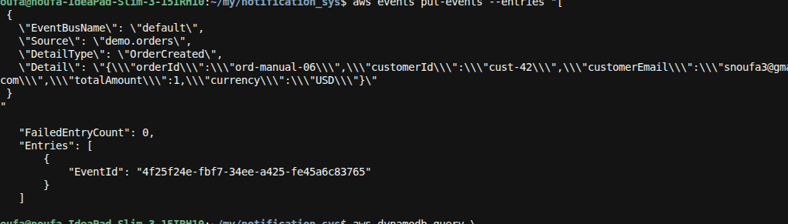
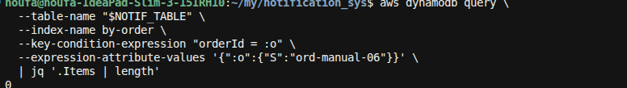
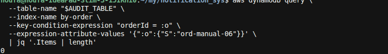

**E2E-06** = publish `OrderCreated` on the **wrong bus** (`default`). The custom bus rule never sees it → no SES email, no audit row.

### 0. Deploy (if needed)
```bash
./scripts/deploy.sh
```

### 1. Resolve outputs
```bash
export BUS_NAME=$(aws cloudformation describe-stacks --stack-name notification-sys \
  --query "Stacks[0].Outputs[?OutputKey=='EventBusName'].OutputValue" --output text)
export NOTIF_TABLE=$(aws cloudformation describe-stacks --stack-name notification-sys \
  --query "Stacks[0].Outputs[?OutputKey=='NotificationsTableName'].OutputValue" --output text)
export AUDIT_TABLE=$(aws cloudformation describe-stacks --stack-name notification-sys \
  --query "Stacks[0].Outputs[?OutputKey=='AuditTableName'].OutputValue" --output text)
```

Confirm the real bus is `notification-sys-orders` (not `default`):
```bash
echo "$BUS_NAME"
```

### 2. Publish OrderCreated on the default bus
```bash
aws events put-events --entries "[
  {
    \"EventBusName\": \"default\",
    \"Source\": \"demo.orders\",
    \"DetailType\": \"OrderCreated\",
    \"Detail\": \"{\\\"orderId\\\":\\\"ord-manual-06\\\",\\\"customerId\\\":\\\"cust-42\\\",\\\"customerEmail\\\":\\\"snoufa3@gmail.com\\\",\\\"totalAmount\\\":1,\\\"currency\\\":\\\"USD\\\"}\"
  }
]"
```
Expect: `FailedEntryCount: 0` (default bus accepted it).



### 3. Wait ~10s, then confirm **no** notification
```bash
aws dynamodb query \
  --table-name "$NOTIF_TABLE" \
  --index-name by-order \
  --key-condition-expression "orderId = :o" \
  --expression-attribute-values '{":o":{"S":"ord-manual-06"}}' \
  | jq '.Items | length'
```

**Pass if:** output is `0`.



### 4. Confirm **no** audit trail row
```bash
aws dynamodb query \
  --table-name "$AUDIT_TABLE" \
  --index-name by-order \
  --key-condition-expression "orderId = :o" \
  --expression-attribute-values '{":o":{"S":"ord-manual-06"}}' \
  | jq '.Items | length'
```

**Pass if:** output is `0`.



### Pass criteria summary
| Check | Expected |
|-------|----------|
| `put-events` on `default` | `FailedEntryCount: 0` |
| Notifications for `ord-manual-06` | **0** items |
| Audit for `ord-manual-06` | **0** items |
| Custom bus TRACE | **no** ingest for this order (event never hit `notification-sys-orders`) |
| Inbox | **no** new OrderPulse email for this order |

### Contrast (optional)
Publish the **same** payload with `EventBusName: $BUS_NAME` — that should fan out and create rows (same as E2E-01).
