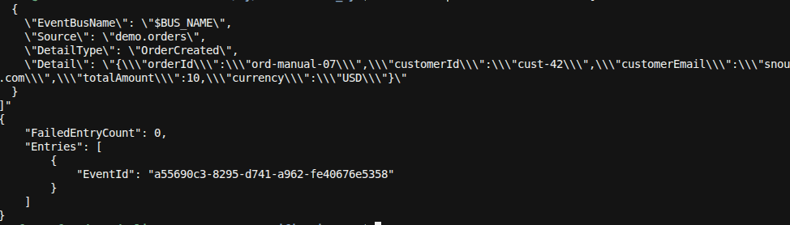
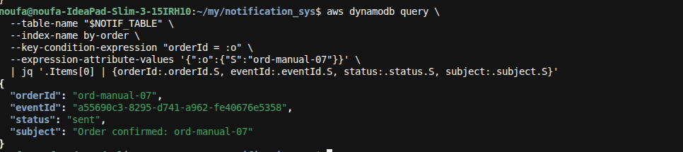
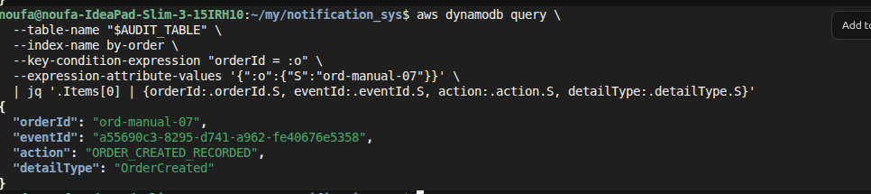
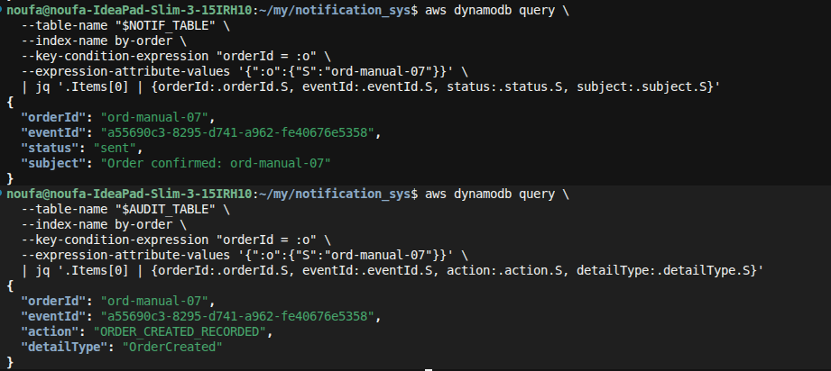

**E2E-07** = publish one `OrderCreated` and confirm **fan-out identity**: the same `orderId` and `eventId` appear on both the notification and audit rows.

### 0. Deploy (if needed)
```bash
./scripts/deploy.sh
```

### 1. Resolve outputs
```bash
export BUS_NAME=$(aws cloudformation describe-stacks --stack-name notification-sys \
  --query "Stacks[0].Outputs[?OutputKey=='EventBusName'].OutputValue" --output text)
export NOTIF_TABLE=$(aws cloudformation describe-stacks --stack-name notification-sys \
  --query "Stacks[0].Outputs[?OutputKey=='NotificationsTableName'].OutputValue" --output text)
export AUDIT_TABLE=$(aws cloudformation describe-stacks --stack-name notification-sys \
  --query "Stacks[0].Outputs[?OutputKey=='AuditTableName'].OutputValue" --output text)
```

### 2. Publish OrderCreated
```bash
aws events put-events --entries "[
  {
    \"EventBusName\": \"$BUS_NAME\",
    \"Source\": \"demo.orders\",
    \"DetailType\": \"OrderCreated\",
    \"Detail\": \"{\\\"orderId\\\":\\\"ord-manual-07\\\",\\\"customerId\\\":\\\"cust-42\\\",\\\"customerEmail\\\":\\\"snoufa3@gmail.com\\\",\\\"totalAmount\\\":10,\\\"currency\\\":\\\"USD\\\"}\"
  }
]"
```
Expect: `FailedEntryCount: 0`. Note the `EventId` from the response — it must match both DynamoDB rows.



### 3. Wait ~10s, then check notifications
```bash
aws dynamodb query \
  --table-name "$NOTIF_TABLE" \
  --index-name by-order \
  --key-condition-expression "orderId = :o" \
  --expression-attribute-values '{":o":{"S":"ord-manual-07"}}' \
  | jq '.Items[0] | {orderId:.orderId.S, eventId:.eventId.S, status:.status.S, subject:.subject.S}'
```

**Pass if:** `orderId` = `ord-manual-07`, `status` = `sent`, and `eventId` equals the `EventId` from step 2.



### 4. Check audit trail
```bash
aws dynamodb query \
  --table-name "$AUDIT_TABLE" \
  --index-name by-order \
  --key-condition-expression "orderId = :o" \
  --expression-attribute-values '{":o":{"S":"ord-manual-07"}}' \
  | jq '.Items[0] | {orderId:.orderId.S, eventId:.eventId.S, action:.action.S, detailType:.detailType.S}'
```

**Pass if:** `orderId` = `ord-manual-07`, `action` = `ORDER_CREATED_RECORDED`, and `eventId` is the **same** as the notifications row.



### 5. Compare side by side
```bash
NOTIF_EID=$(aws dynamodb query --table-name "$NOTIF_TABLE" --index-name by-order \
  --key-condition-expression "orderId = :o" \
  --expression-attribute-values '{":o":{"S":"ord-manual-07"}}' \
  | jq -r '.Items[0].eventId.S')

AUDIT_EID=$(aws dynamodb query --table-name "$AUDIT_TABLE" --index-name by-order \
  --key-condition-expression "orderId = :o" \
  --expression-attribute-values '{":o":{"S":"ord-manual-07"}}' \
  | jq -r '.Items[0].eventId.S')

echo "notif=$NOTIF_EID"
echo "audit=$AUDIT_EID"
[[ "$NOTIF_EID" == "$AUDIT_EID" ]] && echo "PASS: same eventId" || echo "FAIL: eventIds differ"
```



### Pass criteria summary
| Check | Expected |
|-------|----------|
| Notification `orderId` | `ord-manual-07` |
| Audit `orderId` | `ord-manual-07` |
| Notification `eventId` | equals put-events `EventId` |
| Audit `eventId` | **identical** to notification `eventId` |
| Notification `status` | `sent` |
| Audit `action` | `ORDER_CREATED_RECORDED` |
