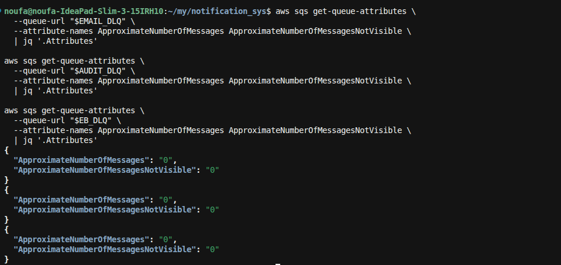

**E2E-09** = healthy path: publish a successful `OrderCreated`, then confirm **all DLQs stay empty** (email worker DLQ, audit worker DLQ, EventBridge target DLQ).

### 0. Deploy (if needed)
```bash
./scripts/deploy.sh
```

### 1. Resolve outputs
```bash
export BUS_NAME=$(aws cloudformation describe-stacks --stack-name notification-sys \
  --query "Stacks[0].Outputs[?OutputKey=='EventBusName'].OutputValue" --output text)
export NOTIF_TABLE=$(aws cloudformation describe-stacks --stack-name notification-sys \
  --query "Stacks[0].Outputs[?OutputKey=='NotificationsTableName'].OutputValue" --output text)
export EMAIL_DLQ=$(aws cloudformation describe-stacks --stack-name notification-sys \
  --query "Stacks[0].Outputs[?OutputKey=='EmailQueueDLQUrl'].OutputValue" --output text)
export AUDIT_DLQ=$(aws cloudformation describe-stacks --stack-name notification-sys \
  --query "Stacks[0].Outputs[?OutputKey=='AuditQueueDLQUrl'].OutputValue" --output text)
export EB_DLQ=$(aws cloudformation describe-stacks --stack-name notification-sys \
  --query "Stacks[0].Outputs[?OutputKey=='EventBridgeDLQUrl'].OutputValue" --output text)
```

### 2. Publish a healthy OrderCreated
```bash
aws events put-events --entries "[
  {
    \"EventBusName\": \"$BUS_NAME\",
    \"Source\": \"demo.orders\",
    \"DetailType\": \"OrderCreated\",
    \"Detail\": \"{\\\"orderId\\\":\\\"ord-manual-09\\\",\\\"customerId\\\":\\\"cust-42\\\",\\\"customerEmail\\\":\\\"snoufa3@gmail.com\\\",\\\"totalAmount\\\":5,\\\"currency\\\":\\\"USD\\\"}\"
  }
]"
```
Expect: `FailedEntryCount: 0`.

### 3. Wait ~10s — confirm workers succeeded
```bash
aws dynamodb query \
  --table-name "$NOTIF_TABLE" \
  --index-name by-order \
  --key-condition-expression "orderId = :o" \
  --expression-attribute-values '{":o":{"S":"ord-manual-09"}}' \
  | jq '.Items[0] | {status:.status.S, sesMessageId:.sesMessageId.S}'
```

**Pass if:** `status` = `sent` (pipeline completed successfully before checking DLQs).

### 4. Check all three DLQ depths
```bash
aws sqs get-queue-attributes \
  --queue-url "$EMAIL_DLQ" \
  --attribute-names ApproximateNumberOfMessages ApproximateNumberOfMessagesNotVisible \
  | jq '.Attributes'

aws sqs get-queue-attributes \
  --queue-url "$AUDIT_DLQ" \
  --attribute-names ApproximateNumberOfMessages ApproximateNumberOfMessagesNotVisible \
  | jq '.Attributes'

aws sqs get-queue-attributes \
  --queue-url "$EB_DLQ" \
  --attribute-names ApproximateNumberOfMessages ApproximateNumberOfMessagesNotVisible \
  | jq '.Attributes'
```

**Pass if:** every queue shows `"ApproximateNumberOfMessages": "0"` (and ideally `NotVisible` is also `0`).



### 5. (Optional) One-liner check
```bash
for url in "$EMAIL_DLQ" "$AUDIT_DLQ" "$EB_DLQ"; do
  echo "$url -> $(aws sqs get-queue-attributes --queue-url "$url" \
    --attribute-names ApproximateNumberOfMessages \
    --query 'Attributes.ApproximateNumberOfMessages' --output text)"
done
```

### Pass criteria summary
| Check | Expected |
|-------|----------|
| Notification for `ord-manual-09` | `status=sent` |
| `notification-sys-email-dlq` | depth **0** |
| `notification-sys-audit-dlq` | depth **0** |
| `notification-sys-eventbridge-dlq` | depth **0** |

Poison messages only land on worker DLQs after **3** failed receives. EventBridge DLQ only gets events when SNS delivery from a rule fails.
