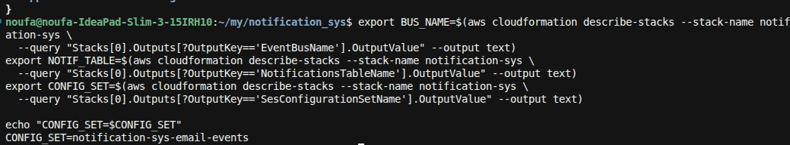
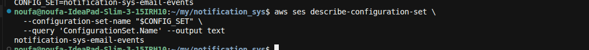
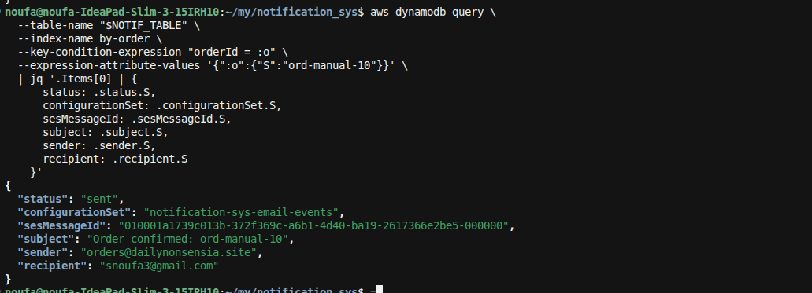

**E2E-10** = publish `OrderCreated` and confirm the notification row uses the SES **configuration set** (`notification-sys-email-events`) for open/click/bounce tracking.

### 0. Deploy (if needed)
```bash
./scripts/deploy.sh
# or with tracking on explicitly:
# ENABLE_SES_TRACKING=true ./scripts/deploy.sh
```

### 1. Resolve outputs
```bash
export BUS_NAME=$(aws cloudformation describe-stacks --stack-name notification-sys \
  --query "Stacks[0].Outputs[?OutputKey=='EventBusName'].OutputValue" --output text)
export NOTIF_TABLE=$(aws cloudformation describe-stacks --stack-name notification-sys \
  --query "Stacks[0].Outputs[?OutputKey=='NotificationsTableName'].OutputValue" --output text)
export CONFIG_SET=$(aws cloudformation describe-stacks --stack-name notification-sys \
  --query "Stacks[0].Outputs[?OutputKey=='SesConfigurationSetName'].OutputValue" --output text)

echo "CONFIG_SET=$CONFIG_SET"
```

**Pass if:** `CONFIG_SET` is `notification-sys-email-events` (not empty / `None`). If missing, redeploy with `ENABLE_SES_TRACKING=true`.



### 2. Confirm the configuration set exists in SES
```bash
aws ses describe-configuration-set \
  --configuration-set-name "$CONFIG_SET" \
  --query 'ConfigurationSet.Name' --output text
```

Expect: `notification-sys-email-events`.



### 3. Publish OrderCreated
```bash
aws events put-events --entries "[
  {
    \"EventBusName\": \"$BUS_NAME\",
    \"Source\": \"demo.orders\",
    \"DetailType\": \"OrderCreated\",
    \"Detail\": \"{\\\"orderId\\\":\\\"ord-manual-10\\\",\\\"customerId\\\":\\\"cust-42\\\",\\\"customerEmail\\\":\\\"snoufa3@gmail.com\\\",\\\"totalAmount\\\":7,\\\"currency\\\":\\\"USD\\\"}\"
  }
]"
```
Expect: `FailedEntryCount: 0`.


### 4. Wait ~10s, then check the notification row
```bash
aws dynamodb query \
  --table-name "$NOTIF_TABLE" \
  --index-name by-order \
  --key-condition-expression "orderId = :o" \
  --expression-attribute-values '{":o":{"S":"ord-manual-10"}}' \
  | jq '.Items[0] | {
      status: .status.S,
      configurationSet: .configurationSet.S,
      sesMessageId: .sesMessageId.S,
      subject: .subject.S,
      sender: .sender.S,
      recipient: .recipient.S
    }'
```

**Pass if:**
- `status` = `sent`
- `configurationSet` = `notification-sys-email-events` (same as `$CONFIG_SET`)
- `sesMessageId` is set



### Pass criteria summary
| Check | Expected |
|-------|----------|
| Stack output `SesConfigurationSetName` | `notification-sys-email-events` |
| SES `describe-configuration-set` | exists |
| Notification `configurationSet` | equals stack output |
| Notification `status` | `sent` |

Open/click events appear as CloudWatch metrics under the configuration set’s event destination (may take time after the recipient opens the mail).
