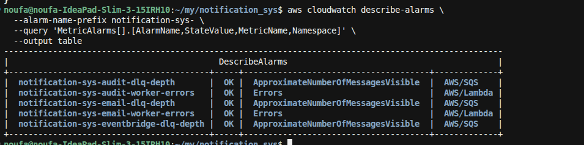
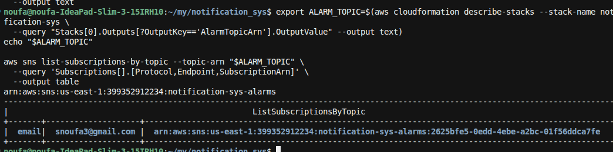

**E2E-11** = confirm CloudWatch **alarms exist** for worker errors and DLQ depth, and that none are in the `ALARM` state after a healthy run.

### 0. Deploy (if needed)
```bash
./scripts/deploy.sh
```

### 1. List alarms for this stack
```bash
aws cloudwatch describe-alarms \
  --alarm-name-prefix notification-sys- \
  --query 'MetricAlarms[].[AlarmName,StateValue,MetricName,Namespace]' \
  --output table
```

**Expect at least these five:**

| Alarm name | Watches |
|------------|---------|
| `notification-sys-email-worker-errors` | Lambda `Errors` |
| `notification-sys-audit-worker-errors` | Lambda `Errors` |
| `notification-sys-email-dlq-depth` | SQS visible messages |
| `notification-sys-audit-dlq-depth` | SQS visible messages |
| `notification-sys-eventbridge-dlq-depth` | SQS visible messages |



### 2. Confirm none are in ALARM
```bash
aws cloudwatch describe-alarms \
  --alarm-name-prefix notification-sys- \
  --state-value ALARM \
  --query 'MetricAlarms[].AlarmName' \
  --output text
```

**Pass if:** output is empty (no alarms currently firing).

States `OK` or `INSUFFICIENT_DATA` are fine for this test. Confirm in the list above that no row shows `ALARM`.

### 3. (Optional) Check alarm SNS topic
```bash
export ALARM_TOPIC=$(aws cloudformation describe-stacks --stack-name notification-sys \
  --query "Stacks[0].Outputs[?OutputKey=='AlarmTopicArn'].OutputValue" --output text)
echo "$ALARM_TOPIC"

aws sns list-subscriptions-by-topic --topic-arn "$ALARM_TOPIC" \
  --query 'Subscriptions[].[Protocol,Endpoint,SubscriptionArn]' \
  --output table
```

Confirm the email subscription to `AlarmEmail` (default `snoufa3@gmail.com`) — it may show `PendingConfirmation` until you click the SNS confirm link.



### 4. (Optional) After a healthy OrderCreated
Run a quick publish (same as E2E-01/09), wait ~1–2 minutes, then re-check step 2 — alarms should still not be `ALARM`.

### Pass criteria summary
| Check | Expected |
|-------|----------|
| Alarm count (prefix `notification-sys-`) | ≥ 5 |
| Alarms in `ALARM` state | **0** |
| Alarm topic | `notification-sys-alarms` exists |
