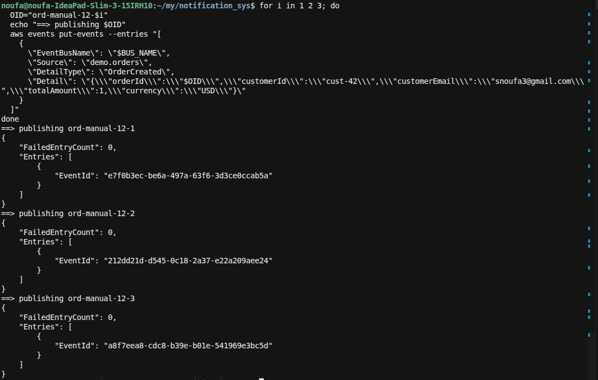
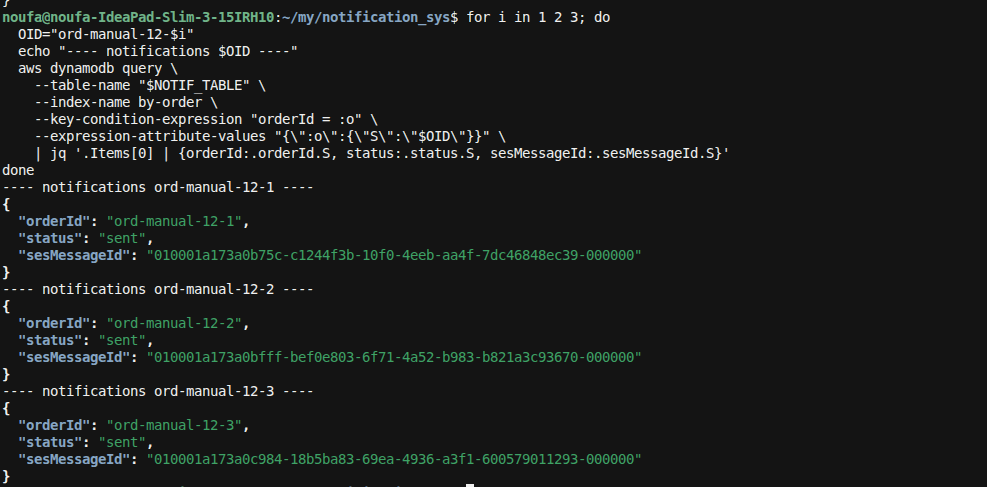
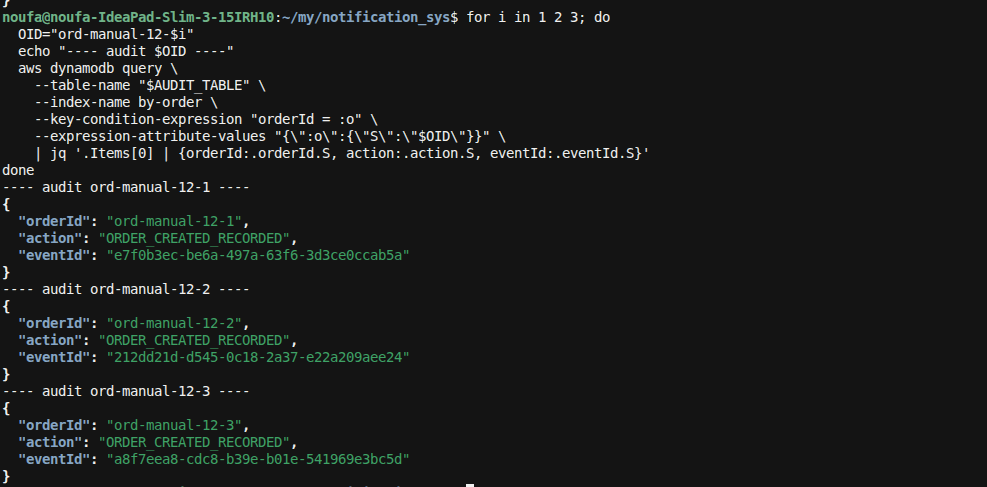
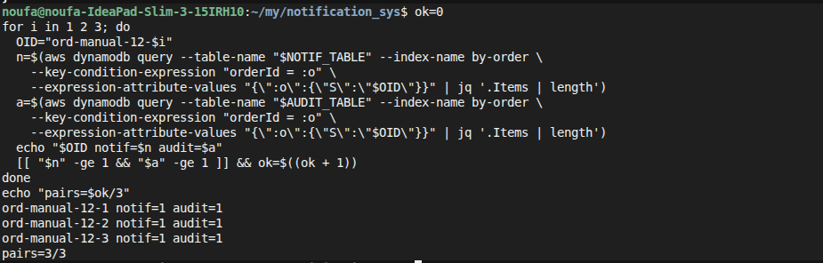

**E2E-12** = burst: publish **3** `OrderCreated` events with different `orderId`s and confirm each gets a notification + audit pair.

### 0. Deploy (if needed)
```bash
./scripts/deploy.sh
```

### 1. Resolve outputs
```bash
export BUS_NAME=$(aws cloudformation describe-stacks --stack-name notification-sys \
  --query "Stacks[0].Outputs[?OutputKey=='EventBusName'].OutputValue" --output text)
export NOTIF_TABLE=$(aws cloudformation describe-stacks --stack-name notification-sys \
  --query "Stacks[0].Outputs[?OutputKey=='NotificationsTableName'].OutputValue" --output text)
export AUDIT_TABLE=$(aws cloudformation describe-stacks --stack-name notification-sys \
  --query "Stacks[0].Outputs[?OutputKey=='AuditTableName'].OutputValue" --output text)
```

### 2. Publish three OrderCreated events
```bash
for i in 1 2 3; do
  OID="ord-manual-12-$i"
  echo "==> publishing $OID"
  aws events put-events --entries "[
    {
      \"EventBusName\": \"$BUS_NAME\",
      \"Source\": \"demo.orders\",
      \"DetailType\": \"OrderCreated\",
      \"Detail\": \"{\\\"orderId\\\":\\\"$OID\\\",\\\"customerId\\\":\\\"cust-42\\\",\\\"customerEmail\\\":\\\"snoufa3@gmail.com\\\",\\\"totalAmount\\\":1,\\\"currency\\\":\\\"USD\\\"}\"
    }
  ]"
done
```
Expect: each response has `FailedEntryCount: 0`.



### 3. Wait ~15s, then check notifications for each order
```bash
for i in 1 2 3; do
  OID="ord-manual-12-$i"
  echo "---- notifications $OID ----"
  aws dynamodb query \
    --table-name "$NOTIF_TABLE" \
    --index-name by-order \
    --key-condition-expression "orderId = :o" \
    --expression-attribute-values "{\":o\":{\"S\":\"$OID\"}}" \
    | jq '.Items[0] | {orderId:.orderId.S, status:.status.S, sesMessageId:.sesMessageId.S}'
done
```

**Pass if:** each `ord-manual-12-1` … `-3` has `status=sent`.



### 4. Check audit trail for each order
```bash
for i in 1 2 3; do
  OID="ord-manual-12-$i"
  echo "---- audit $OID ----"
  aws dynamodb query \
    --table-name "$AUDIT_TABLE" \
    --index-name by-order \
    --key-condition-expression "orderId = :o" \
    --expression-attribute-values "{\":o\":{\"S\":\"$OID\"}}" \
    | jq '.Items[0] | {orderId:.orderId.S, action:.action.S, eventId:.eventId.S}'
done
```

**Pass if:** each order has `action=ORDER_CREATED_RECORDED`.



### 5. (Optional) Count pairs
```bash
ok=0
for i in 1 2 3; do
  OID="ord-manual-12-$i"
  n=$(aws dynamodb query --table-name "$NOTIF_TABLE" --index-name by-order \
    --key-condition-expression "orderId = :o" \
    --expression-attribute-values "{\":o\":{\"S\":\"$OID\"}}" | jq '.Items | length')
  a=$(aws dynamodb query --table-name "$AUDIT_TABLE" --index-name by-order \
    --key-condition-expression "orderId = :o" \
    --expression-attribute-values "{\":o\":{\"S\":\"$OID\"}}" | jq '.Items | length')
  echo "$OID notif=$n audit=$a"
  [[ "$n" -ge 1 && "$a" -ge 1 ]] && ok=$((ok + 1))
done
echo "pairs=$ok/3"
```

**Pass if:** `pairs=3/3`.



### Pass criteria summary
| Check | Expected |
|-------|----------|
| 3× `put-events` | each `FailedEntryCount: 0` |
| Notifications | 1+ row per `ord-manual-12-{1,2,3}`, `status=sent` |
| Audit | 1+ row per order, `ORDER_CREATED_RECORDED` |
| Worker pairs | **3/3** |
